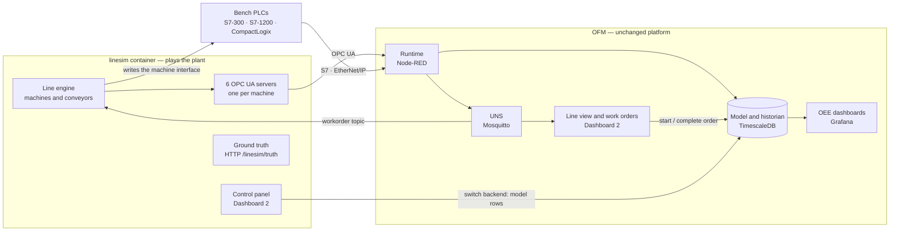

# Simulated packing line — OFM's demo

> **Design reviewed by Jarek 2026-11-02; being built in Phase 3a.** Built so
> far: the line engine, the six simulated OPC UA PLCs and the control panel
> (step 3a.1, section 12). The rest describes what is still to come. Decisions: ADR-0023
> (the simulator), ADR-0024 (starved and blocked time), ADR-0025 (frozen
> data). The line figures were proposed by Claude and accepted as the demo's
> defaults; replace them with your own line's (section 10).

## 1. What it is

A packing line of six machines that runs, slows down, jams, breaks down,
changes over and is cleaned — in software, or partly in real PLCs. OFM
reads it like any plant and shows machine states, work orders, OEE and
downtime. Because the simulator knows exactly what it did, it can tell
whether OFM's figures are right.

Three ways to use it:

- **Without hardware:** every machine is a simulated OPC UA PLC. Start it on
  any computer with Docker.
- **With bench PLCs:** any machine can be switched, in the simulator's
  control panel, to an S7-300, S7-1200 or CompactLogix. The simulator then
  writes that machine's signals into the PLC and OFM reads them from there.
- **As a starting point for your own line:** rename machines, change speeds,
  products and PLC addresses (section 10).

## 2. The pieces



- **`linesim`** is a second Node-RED container from OFM's own image
  (Compose profile `demo`). It is the *plant*: OFM does not know it is a
  simulator.
- **OFM** is the normal stack. Everything the demo shows on the OFM side is
  a real OFM feature (Phase 3a), not demo code.
- **Ground truth** means the simulator's own record of what really
  happened. It is kept off the UNS so OFM cannot "cheat" by reading it; only
  the test suite compares the two.

## 3. The line

| Slot | Machine (`name`) | Rated speed | Counts in | Conveyor after it | Notes |
|---|---|---|---|---|---|
| 1 | Carton erector (`erector`) | 120 cartons/min | cartons | 30 cartons | |
| 2 | Filler (`filler`) | 100 cartons/min | cartons | 20 cartons | **constraint**; counting heads, 6 product types per mix |
| 3 | Checkweigher (`checkweigher`) | 120 cartons/min | cartons | 15 cartons | rejects under- and overweight cartons |
| 4 | Carton closer (`closer`) | 120 cartons/min | cartons | 40 cartons | |
| 5 | Case packer (`case_packer`) | 12 cases/min | cases (10 cartons) | 6 cases | |
| 6 | Palletiser (`palletiser`) | 15 cases/min | cases | — | 60 cases per pallet; full pallet removed by forklift or AGV in 1–3 min |

Speeds, conveyor sizes and the pallet pattern are the demo's defaults:
replace them with the real line's figures before showing it to
management. Machines
around the filler are faster than it, as on a real line (the "V-curve"),
so the filler sets the line's pace.

**Products**, all 10 cartons per case:

| SKU | Description | Rate (cartons/h) | Target weight | Changeover to it |
|---|---|---|---|---|
| `mix150` | Assorted 150 g | 6,000 | 150 g | 10 min |
| `mix250` | Assorted 250 g | 6,000 | 250 g | 15 min |
| `mix500` | Assorted 500 g | 4,800 | 500 g | 20 min |

**Shift pattern**: Monday–Friday 06:00–14:00 and 14:00–22:00
Melbourne time, cleaning 21:30–22:00 (planned). Outside it the line is idle
and OFM books *No activity*.

**How OFM counts the line:** good output = cartons out of the closer;
rejects = filler, checkweigher and closer rejects (cartons that used filler
time). The erector's spoiled blanks count on the erector only. In the model:
the line's KPI rule has the filler as constraint and the closer as output
machine (ADR-0008 amendment, step 3a.4).

## 4. The machine interface

Every machine offers the same nine signals, whatever backend it runs on.

| Signal | Type | Meaning |
|---|---|---|
| `state` | INT | 1 running, 2 idle, 3 blocked, 4 starved, 5 fault, 6 setup, 7 cleaning, 8 maintenance (in OFM: property `state_code`) |
| `fault_code` | INT | 0 = none; otherwise the machine's fault number (below) |
| `count_in` | DINT | units processed (good plus rejected) since the simulator started; only ever rises |
| `count_good` | DINT | good units passed on |
| `count_reject` | DINT | units rejected |
| `speed` | REAL | actual speed, units/min |
| `speed_setpoint` | REAL | set speed, units/min |
| `heartbeat` | DINT | +1 every second while the simulator runs; OFM watches it (ADR-0025) |
| `process_value` | REAL | one machine-specific value: checkweigher last weight (g), palletiser pallets completed, others 0 (in OFM: `last_weight`, `pallets`; not mapped on the other machines) |

In OFM each signal is an ordinary property, on the topic
`acme/melbourne/packing/packline01/<machine>/<property>` (50 properties,
loaded by `docker compose run --rm migrate demo`, section 12). The PLC's
state code is the property `state_code`, because `state` is the machine
state OFM derives from it itself (step 3a.3). Each machine has eight state
rules on `state_code` (code 1 → running … 8 → maintenance, Overview §10.1);
the six signals the KPIs need have their role (`state_code`, `fault_code`,
`heartbeat`, `count_in`, `count_good`, `count_reject`); `heartbeat` has a
5-second timeout; each `fault_code` value below is mapped to a reason of
its machine (step 3a.6). All of it is in the model, so a real machine with different codes, or
with status bits instead of a code, needs only different rows.

**Frozen data.** If `heartbeat` stops changing for 5 seconds while the PLC or
OPC UA server still answers — the simulator stopped, a CPU in STOP — OFM
marks every value of that machine `bad` and the machine `unknown`, until
the heartbeat moves again (ADR-0025). *Stop simulator* in the control panel
shows it.

**Fault codes** (each maps to a reason in OFM's catalogue):

| Machine | Code: reason (loss position) |
|---|---|
| erector | 101 blank magazine empty (12) · 102 carton jam (12) · 103 glue system fault (9) · 104 vacuum fault (9) |
| filler | 201 product supply low (12) · 202 counting head fault (9) · 203 carton jam (12) |
| checkweigher | 301 reject bin full (12) · 302 load cell fault (9) |
| closer | 401 glue fault (9) · 402 carton jam (12) · 403 flap guide fault (9) |
| case_packer | 501 case blanks empty (12) · 502 case jam (12) · 503 servo fault (9) |
| palletiser | 601 waiting for pallet removal (12) · 602 empty pallets out (12) · 604 robot fault (9) |
| any | 999 unknown fault — no reason; the operator codes it on the line view |

In OFM (step 3a.6) each of these is a reason in `config.reason`, named
after its machine (`erector_glue_system_fault`, …), mapped in
`config.fault_code_reason`; six more reasons are there for operators to
code stops by hand, for any machine: *breakdown, other* (9), *minor stop,
other* (12), *material quality* (12), *meal break* (7), *planned
maintenance* (4), *extra cleaning* (5). The line's KPI rule has
`order_required`: stopped time without an active order is *waiting for
order* (7).

Position 9 is *Breakdowns*, 12 *Other unplanned downtime* (ADR-0008).

## 5. Backends and addresses

Each machine's backend is chosen in the control panel. Addresses depend on
the slot (1–6), not on the machine's name, so renaming a machine in OFM
breaks nothing.

| Signal | Simulated OPC UA (node in `urn:ofm:linesim:m<slot>`) | S7: DB `100+slot`, offset | S7 address in OFM (slot 2) | CompactLogix tag (slot 2) |
|---|---|---|---|---|
| `state` | `State` | 0.0 INT | `DB102,INT0` | `OFM_M2_State` (INT) |
| `fault_code` | `FaultCode` | 2.0 INT | `DB102,INT2` | `OFM_M2_FaultCode` (INT) |
| `count_in` | `CountIn` | 4.0 DINT | `DB102,DINT4` | `OFM_M2_CountIn` (DINT) |
| `count_good` | `CountGood` | 8.0 DINT | `DB102,DINT8` | `OFM_M2_CountGood` (DINT) |
| `count_reject` | `CountReject` | 12.0 DINT | `DB102,DINT12` | `OFM_M2_CountReject` (DINT) |
| `speed` | `Speed` | 16.0 REAL | `DB102,REAL16` | `OFM_M2_Speed` (REAL) |
| `speed_setpoint` | `SpeedSetpoint` | 20.0 REAL | `DB102,REAL20` | `OFM_M2_SpeedSetpoint` (REAL) |
| `heartbeat` | `Heartbeat` | 24.0 DINT | `DB102,DINT24` | `OFM_M2_Heartbeat` (DINT) |
| `process_value` | `ProcessValue` | 28.0 REAL | `DB102,REAL28` | `OFM_M2_ProcessValue` (REAL) |

- **Simulated OPC UA:** machine *n* is the server `opc.tcp://linesim:484<n>`
  (4841–4846) inside the stack, `opc.tcp://localhost:484<n>` from this
  computer (for a desktop OPC UA client). No encryption, no login. Values
  carry the simulator's own timestamps (`tss: device`). Types: INT as
  Int16, DINT as Int32, REAL as Double (a 32-bit REAL would turn 96.2 into
  96.19999694824219).
- **S7-300 / S7-1200:** one data block per machine, **standard access**
  (optimised access off), no program logic. The demo ships the block as a
  source file to import: TIA Portal (*External source files → Generate
  blocks*) and SIMATIC Manager (STL source). PUT/GET must be permitted on an
  S7-1200 — bench only (ADR-0021).
- **CompactLogix:** controller-scope tags, shipped as a tag file for
  Studio 5000 (*Tools → Import → Tags and Logic Comments*).
- **Sharing a PLC:** several machines may use the same PLC; each has its own
  block or tag prefix.
- In the model the demo creates sources `linesim_m1` … `linesim_m6` (OPC UA)
  and `demo_s7300`, `demo_s71200`, `demo_logix` (switched off until their IP
  address is set).

**Switching a backend** in the panel does two things: the simulator starts
writing that machine's signals to the new backend, and it calls
`demo.set_machine_backend(slot, backend)` in OFM's database. That function
rewrites the machine's nine `plc_mapping` rows (source and address) in one
transaction; OFM reconnects within a second. The function runs with fixed,
limited rights — like a key switch that allows exactly one operation — under
the role `ofm_demo`, and the audit log records it. The same change made by
hand in Mathesar is a good "ease of use" moment in the demo.

## 6. How the simulator works

- **Tick:** every 100 ms the engine moves each machine forward: takes units
  from the conveyor before it, passes good units to the conveyor after it.
- **Starved and blocked:** a machine with an empty infeed conveyor is
  `starved`; one whose outfeed conveyor is full is `blocked`. A breakdown
  therefore spreads up and down the line with a delay set by the conveyor
  sizes, as on the floor.
- **Breakdowns:** random, on average once per *MTBF* (mean time between
  failures, in running hours), lasting about *MTTR* (mean time to repair),
  with a fault code from the machine's list.
- **Jams:** short stops (10–90 s) at a rate per hour; OFM books them as
  minor stops (under the 5-minute threshold).
- **Speed:** each machine runs at a percentage of its rated speed (speed
  loss).
- **Quality:** the filler's count accuracy sets the spread of carton
  weights; the checkweigher rejects outside the limits; other machines have
  a small reject percentage.
- **Changeover:** when OFM starts a new work order, all machines go to
  `setup` for the product's changeover time (±20 %), then run the new
  product's speed and target weight.
- **Shift pattern and cleaning:** the line stops at the end of the
  pattern, cleans for 30 minutes, and starts at the next shift.
- **Presets:** *Good day* (OEE about 75 %), *Typical* (about 60 %), *Bad
  day* (about 40 %), or every value by hand. The result is
  never set directly: OEE comes out of the causes, and the simulator's own
  ledger shows what it really was.
- **Real time only:** the historian files values at real time, so history
  builds up as the simulator runs. Start it a week or two before a demo.

## 7. Work orders

OFM owns the work orders (ADR-0010); the simulator behaves like the
operators who set the line up.

1. An operator starts an order on OFM's line view: product and quantity.
2. OFM records the `start` event and publishes the active order, retained,
   on `.../packline01/workorder`.
3. The simulator reads it: changeover (`setup`), then the new product.
4. The first good carton closes the changeover window (or the operator
   presses *Changeover done*).
5. At the planned quantity the line stops; the operator completes the order
   and starts the next one.

Time inside the shift pattern with no active order is booked automatically
as **waiting for order** (Pos 7 *Other planned downtime*), so it never
needs coding and never hides among breakdowns. OFM does this by adding the
reason itself to such stops (`assigned_by = 'ofm'`), so the classification
rules of ADR-0009 stay as they are and a supervisor can still correct it.

The **auto-operator** (on/off in the panel) does steps 1 and 5 by itself
from a production plan in `line.json`, through `demo.start_order(...)`, so
the line can run unattended for weeks with realistic changeovers.

*As built (step 3a.5):* the panel's *Start order* and *Complete* stand in
for the operator. Starting an order completes the running one, so step 5 is
one action. Operating details: section 13, *Work orders*.
*As built (step 3a.8):* OFM's line view does steps 1, 4 and 5 as a
signed-in person (section 13, *The line view*); the panel's buttons and the
auto-operator still work.

## 8. Screens

| Screen | Where | Shows |
|---|---|---|
| Simulator control panel | linesim, `https://<server>:1881/dashboard` | the line with conveyor levels; per machine: speed %, MTBF, MTTR, jams/h, rejects; buttons *Break*, *Break and hold*, *Jam*, *Repair*; run/stop the line, stop the simulator, shift pattern on/off, product changeover, presets; this hour's output against rated *(built, step 3a.1)*; work orders: follow on/off, auto-operator, start and complete an order *(built, step 3a.5)*. Later: backend per machine (3a.9), the simulator's own OEE (3a.10) |
| Line view | OFM (container `ofm-screens`, ADR-0027), `https://<server>:1882/dashboard` | the line from the UNS: machines in flow order, coloured by state, time in state, fault code; KPIs of this hour, today and the order; the active order with *Start*, *Changeover done*, *Complete*; stops waiting for a reason, coded by a signed-in person (ADR-0028) *(built, step 3a.8)* |
| Line OEE | Grafana | OEE with availability, performance and quality per shift and hour; loss waterfall; downtime Pareto by reason and by machine; MTBF and MTTR per machine |

## 9. Tests

An opt-in suite, `docker compose run --rm test demo`, compares OFM with the
simulator's ground truth for every complete hour of the last day:

- good and reject counts: within 2 cartons per hour (counts near the hour
  boundary may fall either side);
- time per loss position, including starved and blocked time attributed to
  the right machine (ADR-0024): within 1 minute per hour;
- OEE, availability, performance and quality: within 1 percentage point;
- the machine list in `line.json` matches the demo model.

## 10. Adapting it to your line

- **Names and topics:** rename the line and machines in Mathesar; history is
  kept (it is stored by ID, ADR-0004).
- **Speeds, products, shift pattern:** in Mathesar (OFM's figures) and in
  `line.json` (the simulator's behaviour).
- **Your PLCs:** set the IP address and rack/slot of `demo_s7300`,
  `demo_s71200` or `demo_logix` in Mathesar, import the data block or tag
  file into the PLC, then pick the PLC in the control panel.
- **Fewer machines:** switch a slot off in `line.json` (the engine is
  generic for a single chain of up to 10 machines; the shipped model has
  six).

## 11. Decided in the review (2026-11-02)

1. Line speeds, conveyor sizes, products, shift pattern and fault codes as
   above; fault 604 is *robot fault*.
2. Idle time inside the shift pattern with no active order: automatic
   reason *waiting for order*, Pos 7 (section 7).
3. OFM watches `heartbeat` from the start (ADR-0025).
4. Switching a backend in the control panel changes OFM's model
   automatically (`demo.set_machine_backend`, section 5).

## 12. Running the simulator (step 3a.1)

**Start it** (laptop, PowerShell in `C:\ofm\deploy`): add `demo` to
`COMPOSE_PROFILES` in `.env` (e.g. `COMPOSE_PROFILES=simulator,demo`), then

```powershell
docker compose up -d
docker compose ps linesim
docker compose logs linesim
```

`linesim` should be *running*; the log ends with `Started flows` and no
`[error]` lines. The first start takes about 10 seconds longer while each
simulated PLC creates its OPC UA certificate.

**Look at it:** `https://localhost:1881` is the simulator's Node-RED editor
(same login as OFM's editor), tab *Line simulator*. Under each node a status
line shows what it does:

- *load line.json*: `6 machines, loaded …`;
- *line engine*: `run · mix250 · filler running 97/min · good …` — or `off`
  outside the shift pattern (Monday–Friday 06:00–22:00 Melbourne time);
- *simulated OPC UA PLCs*: `6 of 6 OPC UA servers up, ports 4841-4846`.

**Put it in OFM's model** (step 3a.2), so OFM reads it:

```powershell
docker compose run --rm migrate demo
```

It adds the line `acme/melbourne/packing/packline01` with its six machines
and 50 properties, the sources `linesim_m1` … `linesim_m6`, the products
mix150, mix250 and mix500 with their rated speeds, the line's KPI rules
(filler as constraint, minor stops under 5 minutes), its shift pattern and
the machines' flow order (`db/examples/demo-packline.sql`). Running it again
adds nothing twice. `docker compose run --rm migrate demo-remove` takes all
of it away again, with its history; the example line `eggline01` stays.
Load the demo only while the simulator runs, or OFM's `live` checks report
its 50 properties as not current.

**Check it:** `docker compose run --rm test live` includes a check that
reads all six simulated PLCs (part of *linesim*); it is skipped when the
simulator is not running.

**Machine states** (step 3a.3): OFM derives each machine's state from its
state rules and publishes it retained on
`acme/melbourne/packing/packline01/<machine>/state`, for example
`{"v": "starved", "ts": 1793869183310, "q": "good", "tss": "device"}`;
`ts` is when the state began. Watch the six topics in MQTT Explorer while
you break a machine in the control panel. In OFM's Node-RED editor the node
*machine states* shows how many machines are in which state. Every change
is also a row in the historian; the last hour, in Melbourne time:

```sql
SELECT machine_name, starts_at AT TIME ZONE 'Australia/Melbourne' AS started,
       state, round(duration_s) AS seconds, cause
FROM hist.vw_machine_state_interval
WHERE line_id = (SELECT id FROM config.line WHERE name = 'packline01' AND retired_at IS NULL)
  AND starts_at > now() - interval '1 hour'
ORDER BY machine_name, starts_at;
```

(in `docker exec -it ofm-timescaledb psql -U ofm_admin -d ofm`, with the
administrator name from your `.env`). Charts of states come with the line
view in step 3a.8.

**Counts** (step 3a.4): OFM turns every machine's counters into cartons
(or cases) made per minute, and the line's good and reject cartons per
minute. The last hour, per hour and in total, in Melbourne time, to compare
with the panel's *This hour*:

```sql
SELECT date_trunc('hour', ts AT TIME ZONE 'Australia/Melbourne') AS hour,
       sum(good) AS good, sum(reject) AS reject
FROM hist.vw_line_count
WHERE line_id = (SELECT id FROM config.line WHERE name = 'packline01' AND retired_at IS NULL)
  AND ts > now() - interval '2 hours'
GROUP BY 1 ORDER BY 1;
```

Per machine and minute: `hist.vw_production_count` (columns `machine_name`,
`role`, `increment`, `resets`). A minute is written about 5 seconds after it
ends, so the current minute is not there yet. *New run* resets the counters
to 0: OFM logs `counter … was reset: 290 -> 0` for each and loses nothing.

**Outside the shift pattern**, to see the line run: set
`"schedule": { "enabled": false, … }` in `line.json`, then
`docker compose restart linesim`. Set it back afterwards.

**Good to know:**

- Editing `line.json` takes effect at `docker compose restart linesim`.
  Counters and the product start again (counters from 0, product
  `freeRunSku`) at every restart of the container or full Deploy, like a
  PLC without retentive data; OFM handles counter resets (step 3a.4), and
  from step 3a.5 the simulator takes the product from OFM's active work
  order. If only `line.json` is read again (the *start-up* inject), the
  counters, product and a running changeover are kept.
- On a Linux host the folder `demo/packing-line` must be writable by user
  1000 for Deploy (`sudo chown -R 1000:1000 demo/packing-line`), as for
  `flows/`.
- The control panel is not behind a login (Node-RED's editor login does
  not cover dashboards): anyone who can open port 1881 can stop the line.
  On the laptop that is only you; do not open the demo to a plant network.

**The control panel:** `https://localhost:1881/dashboard` — how to use it
is section 13.

## 13. Operating the simulator

The simulator always runs once its container is up, as a real line always
exists; the control panel decides whether the line produces, much as
operators and supervisors do on the floor.

### What decides whether the line produces

The engine checks these every 100 ms, in this order; the coloured badge at
the top left of the panel shows the result.

| Badge | When | Machines |
|---|---|---|
| SIMULATOR STOPPED | *Stop simulator* was pressed | everything frozen (below) |
| STOPPED | *Stop line* was pressed | all idle (grey) |
| OFF SHIFT | shift pattern on, outside Mon–Fri 06:00–22:00 | all idle (grey) |
| CLEANING | shift pattern on, 21:30–22:00 | all cleaning (teal) |
| CHANGEOVER | a changeover is counting down | all setup (blue) |
| WAITING FOR ORDER | *Follow OFM work orders* on, and no active order, or its planned quantity is made | all idle (grey) |
| RUN | none of the above | producing, with random breakdowns, jams, shortages and rejects |

### The buttons at the top

**Stop line / Run line** is the operator stopping the whole line. One
button; its label shows what pressing it will do. The line runs by itself,
so there is no "Start line": *Run line* appears only after *Stop line*.
While stopped, machines are idle and make nothing, get no new random
breakdowns (machines only wear while running), and a breakdown already in
progress keeps counting down. Once OFM reads the line, this is downtime
during the shift that someone has to give a reason for.

**Stop simulator / Resume simulator** is not a production event but a
fault in the data: it imitates a PLC whose program has stopped, or a data
block nobody updates any more. Every value freezes, including the
heartbeat; the time in between is skipped, not caught up. It exists to test
OFM's frozen-data detection, not for normal simulation: about 5 seconds
later OFM marks every value of every machine `bad` and the machines
`unknown` from the last heartbeat change, and about 2 seconds after
*Resume simulator* they are live again (ADR-0025, drill F1 in
`tests/README.md`).

**New run** starts a fresh run without restarting the container, after a
confirmation: every counter to 0, conveyors empty, all breakdowns cleared, a
running changeover cancelled, the line running (also after *Stop line* or
*Stop simulator*). Product and settings stay; the preset *As in line.json*
resets the settings too. Once OFM reads the line, a new run erases nothing
in OFM's history: OFM sees the counters drop to 0, as when a PLC is
reloaded, and handles that from step 3a.4.

**Shift pattern: on / off.** On: the line runs Mon–Fri 06:00–22:00, cleans
21:30–22:00, and is idle at night and at weekends — the realistic setting
for long unattended runs; OFM will count off-shift time as *No activity*.
Off: the line runs 24/7, for testing in the evening or at weekends. For the
management demo keep it on, so that it matches OFM's shift calendar
(step 3a.2).

### Normal procedure

Inside shift hours the line is already producing when the panel opens;
nothing needs starting.

1. Open `https://localhost:1881/dashboard`; inside shift hours the badge
   says RUN.
2. Optional: pick a **preset** and press *Apply* — *Good day* about 75 % of
   rated output, *Typical* 60 %, *Bad day* 40 % — or edit single values in
   the table (speed %, MTBF, MTTR, jams per hour, rejects %; a change
   applies when you leave the field).
3. Let it run. Breakdowns, jams, material shortages and rejects come
   randomly, so the line looks alive on its own.
4. To show something on purpose: **Break** (a breakdown lasting about the
   machine's MTTR, mean time to repair), **Break and hold** (broken until
   *Repair* — the presenter decides when it ends), **Jam** (a 30-second
   minor stop).
5. Watch the effect spread through the conveyors: machines before a broken
   one fill up and turn orange (blocked), machines after it run empty and
   turn yellow (starved).

The picture shows, per machine, actual / set speed, good and rejected
count, fault code and the time left to repair, and how full each conveyor
is. *This hour* is the simulator's own rough count of good cartons against
what the line could have made at rated speed while scheduled to run — not
OFM's OEE. Presets scale the values in `line.json` (`presets` there);
measured over 8-hour runs, *Good day* 75 %, *Typical* 60 %, *Bad day* 41 %
of rated output on average, about ±10 points on any one day.

### Changeover

1. Pick the new product in the list. The minutes box fills in with that
   product's usual changeover time from `line.json` (mix150 10, mix250 15,
   mix500 20 minutes).
2. Change the minutes if wanted, for example 2 for a quick test.
3. Press *Change over*: all machines show SETUP and the countdown runs at
   the top.
4. At zero the line runs the new product: the filler's set speed follows
   the product's rate (mix500: 80/min × 97 % = 77.6), and the checkweigher
   weighs around the new target weight.

A changeover can start while the line is running or stopped. The conveyors
are not emptied: cartons of the old product finish their way down the line
(a simplification). The countdown is clock time, so it keeps running while
the line is stopped or off shift. Since step 3a.5 changeovers normally
start from OFM's work orders and the simulator follows them (below); the
panel's *Change over* stays for testing.

### Work orders (step 3a.5)

OFM owns the work orders; the simulator plays the line and its operator.
The blue-grey row under the top bar shows the active order (number,
product, cartons made of planned) and three controls.

- **Follow OFM work orders: on** (the default). The line makes only what
  OFM's active order asks for: a new product means a changeover; at the
  planned quantity of good cartons at the closer the line stops; with no
  active order it waits (badge WAITING FOR ORDER). *Off*: the line runs
  freely, as before step 3a.5, for testing the simulator alone.
- **Auto-operator: on** (the default). When the line has run out of work
  inside the shift pattern, it waits 2 minutes (an operator's reaction) and
  starts the next order of the plan in `line.json` (`orders.autoOperator`:
  mix250 × 6000, mix500 × 4000, mix150 × 5000, in turn), which completes the
  finished one. The panel shows the next order and when it starts. With it
  on and the shift pattern on, the line runs unattended for weeks with
  realistic changeovers.
- **Start order** (product, quantity, *Start*) and **Complete** do what an
  operator will do on OFM's line view (step 3a.8): *Start* creates the
  order in OFM and starts it, completing the running one; *Complete* ends
  the running one, and the line waits.

What happens with an order: the simulator asks OFM's database
(`demo.start_order`, as the role `ofm_demo`); OFM records the start and
publishes the order on `acme/melbourne/packing/packline01/workorder`; the
simulator reads that and changes over. OFM closes the changeover window at
the first good carton at the closer (`changeover_end`, entered by `ofm`).
A red message in the row means the database refused, e.g. *the demo is
not loaded in OFM* or a password problem (`OFM_DEMO_DB_PASSWORD`, step
3a.5 in `tests/README.md`).

The orders and their events, in Melbourne time:

```sql
SELECT wo_number, sku, planned_qty,
       started_at AT TIME ZONE 'Australia/Melbourne' AS started,
       changeover_end_at AT TIME ZONE 'Australia/Melbourne' AS changeover_end,
       completed_at AT TIME ZONE 'Australia/Melbourne' AS completed, started_by
FROM hist.vw_work_order_interval ORDER BY started_at DESC LIMIT 10;
```

The panel's *Change over* still changes the product without an order (for
testing); with *Follow* on, the next order's product wins.

### Stops and their reasons (step 3a.6)

When a machine stops with a fault code, OFM records that code's reason for
the stop at once (`assigned_by` = plc). The filler is the line's
constraint: when it is starved or blocked, OFM charges that time to the
stopped machine upstream or downstream and its reason. To see it, *Break
and hold* the erector, wait until the filler turns yellow (starved), wait a
minute, *Repair*; then the line's stop list for the last 15 minutes:

```sql
SELECT slice_start AT TIME ZONE 'Australia/Melbourne' AS started, round(duration_s) AS seconds,
       state, cause, reason_name, loss_category_id AS pos, cause_machine_name AS charged_to, assigned_by
FROM hist.fn_line_stops((SELECT id FROM config.line WHERE name = 'packline01' AND retired_at IS NULL),
                        now() - interval '15 minutes', now());
```

`cause`: `reason` (the filler's own), `attributed` (charged to
`charged_to`), `flow` (starved or blocked while its neighbours ran: the
conveyor refilling), `waiting_for_order`, `unknown`, or `none` (not coded
yet; a minor stop if short, see the time ledger below). Stops waiting for a
reason are coded on the line view (below). By hand, as administrator, e.g.
to correct the PLC's reason of the closer's latest fault:

```sql
SELECT config.fn_assign_reason(e.machine_id, e.ts, 'breakdown_other', 'Jarek', 'motor overload reset')
FROM hist.machine_state_event e
WHERE e.machine_id = (SELECT id FROM config.machine WHERE name = 'closer' AND retired_at IS NULL)
  AND e.state_id = 5                     -- 5 = fault
ORDER BY e.ts DESC LIMIT 1;
```

The panel's *Break* always uses the machine's first fault code; a 999
(unknown fault) only comes at random.

### Efficiency: the time ledger and KPIs (step 3a.7)

OFM puts every second of the line's time into one position of the loss
waterfall (ADR-0008, ADR-0009) and calculates the KPIs from it, always from
the history, so a reason coded late changes the figures at once. The
filler is the constraint, so its state decides the line's time; cartons
are counted at the closer (good) and from the filler to the closer
(rejects).

**Live, in the UNS** (MQTT Explorer), republished every minute:
`acme/melbourne/packing/packline01/kpi/hour`, `.../kpi/day` (from midnight,
Melbourne time) and `.../kpi/order` (since the running order started;
cleared while no order runs). Ratios are 0–1 (`0.712` = 71.2 %).

**Outside the schedule nothing counts.** The demo's schedule is Monday to
Friday 06:00–22:00 (cleaning 21:30–22:00); outside it every second is
position 2 (no activity) and the KPIs are empty (`null`), even if the line
runs. To try it on a weekend, switch *Shift pattern* off in the panel and
add a production window for today only (remove it afterwards):

```sql
INSERT INTO config.line_schedule (line_id, kind, sat, sun, start_time, end_time, valid_from, valid_to, note)
SELECT id, 'production', true, true, '00:00', '23:59', current_date, current_date, 'weekend test'
FROM config.line WHERE name = 'packline01' AND retired_at IS NULL;
-- afterwards:
DELETE FROM config.line_schedule WHERE note = 'weekend test';
```

**Today's waterfall and KPIs** (the same figures as `.../kpi/day`):

```sql
SELECT round(pos1_s) AS calendar_s, round(pos2_s) AS no_activity_s, round(pos3_s) AS scheduled_s,
       round(pos6_s) AS changeover_s, round(pos7_s) AS other_planned_s, round(pos9_s) AS breakdown_s,
       round(pos12_s) AS minor_stops_s, round(unaccounted_s) AS unaccounted_s, round(running_s) AS running_s,
       good, reject, round(oee::numeric, 3) AS oee, round(availability::numeric, 3) AS a,
       round(performance::numeric, 3) AS p, round(quality::numeric, 3) AS q
FROM hist.fn_line_kpi((SELECT id FROM config.line WHERE name = 'packline01' AND retired_at IS NULL),
                      date_trunc('day', now() AT TIME ZONE 'Australia/Melbourne') AT TIME ZONE 'Australia/Melbourne', now());
```

Per hour of today: `hist.fn_line_kpi_series(line, from, to, 'hour')` with
the same columns plus `period_start` (also `'day'`, `'week'`, `'month'`).

**The time ledger**, slice by slice, for the last 15 minutes:

```sql
SELECT slice_start AT TIME ZONE 'Australia/Melbourne' AS started, round(duration_s) AS seconds,
       loss_category_id AS pos, rule, state, reason_name, cause_machine_name AS charged_to, round(stop_s) AS stop_s
FROM hist.fn_time_ledger((SELECT id FROM config.line WHERE name = 'packline01' AND retired_at IS NULL),
                         now() - interval '15 minutes', now());
```

`rule` says why the slice landed in its position: `running` (no position:
split into speed loss, quality loss and operating time by the counts),
`reason`, `attributed`, `waiting_for_order` (the reason's position), `flow`
(12), `changeover` (6), `planned_window` (the cleaning window: 5),
`minor_stop` (12: a stop of the filler shorter than 5 minutes, not coded),
`unaccounted` (a longer stop nobody has coded yet), `unknown`,
`no_activity` (2). `stop_s` is the length of the whole stop the slice
belongs to.

**Breakdowns per machine** (MTBF in hours, MTTR in minutes), last 24 hours:

```sql
SELECT machine_name, round(running_s) AS running_s, breakdowns, round(mtbf_h::numeric, 2) AS mtbf_h,
       round(mttr_min::numeric, 1) AS mttr_min
FROM hist.fn_machine_reliability((SELECT id FROM config.line WHERE name = 'packline01' AND retired_at IS NULL),
                                 now() - interval '24 hours', now());
```

A breakdown is a machine's own stop with a position 9 reason (e.g. the
erector's glue system fault, 103).

### The line view (step 3a.8)

Open `https://localhost:1882/dashboard` (another computer: the server's
name instead of localhost). Anyone can look; to change something, sign in.

- **Sign in:** *Sign in*, employee number `1001`, `1002` or `1003` (the demo
  people), then the PIN. The first time, the screen asks you to choose a PIN
  (4 to 8 digits, typed twice). The keypad is for touch screens; a keyboard
  works too. Your name stays at the top right until *Sign out*, 5 minutes
  without touching the screen (the countdown next to it), a reload, or
  signing in on another screen. A forgotten PIN: delete the person's row in
  Mathesar, table *person_pin*; add people in table *person*.
- **The line:** the six machines in flow order, coloured by state (green
  running, grey idle, amber starved or blocked, red fault, blue setup,
  cleaning or maintenance, magenta unknown), how long, the fault code.
- **Efficiency:** OEE with availability, performance and quality for this
  hour, today and the running order, from `…/kpi/…` (section 13,
  *Efficiency*); *not accounted for* = scheduled time nobody has explained.
- **Work order:** *Start an order…*: a planned order (planned in Mathesar,
  table *work_order*) or a new one (product and quantity); this completes
  the running one. A new product means a changeover: the machines show
  *SETUP* and nothing is made for the product's changeover time from
  `line.json` (mix150 10, mix250 15, mix500 20 minutes, give or take 20 %;
  the same product: none). *Changeover done* tells the simulator the crew
  has finished: the line starts at once. Not signed in? The screen asks for your sign-in first
  and then carries on with the action (*Cancel* drops it). The dialog shows
  *Working…* until OFM answers, then closes with a green message at the top,
  or stays open and shows in red why it was refused. *Changeover done* while the changeover is open (OFM also
  closes it at the first good carton). *Complete* asks first. The simulator
  follows, as with the panel's buttons.
- **Stops waiting for a reason:** stops of the filler longer than 5 minutes
  in the last 24 hours that nobody has coded, or, when the filler was
  starved or blocked, the stop of the machine that caused it. *Code…*, pick
  the reason (that machine's own first, then general ones), optionally a
  comment, *Save*. The stop leaves the list and its time moves from *not
  accounted for* to the reason's loss. Try it: *Stop line* in the panel,
  wait 6 minutes, *Run line*: the filler's idle stop appears within 30 s (a
  stop with a PLC fault code already has its reason and does not).

Who did what is recorded by ID and name: `entered_by` and `person_id` in
`hist.work_order_event`, `assigned_by` and `person_id` in
`hist.state_reason`; every sign-in attempt in `hist.person_sign_in`.

### What restarts do

| Action | Counters | Product | Panel settings and presets |
|---|---|---|---|
| `docker compose restart linesim` | back to 0 | back to mix250, then the active order's | back to `line.json`; the active order's full quantity is made again |
| *New run* | back to 0 | kept | kept |
| Preset *As in line.json* | kept | kept | back to `line.json` |

Counters only ever go up while the simulator runs, like PLC counters.
