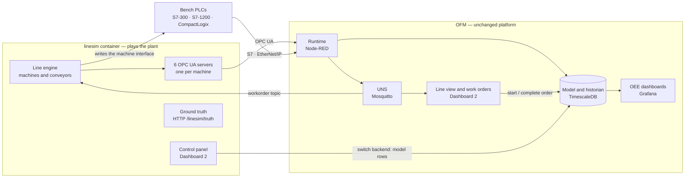

# Simulated packing line — OFM's demo

> **Design reviewed by Jarek 2026-11-02; being built in Phase 3a.** Built so
> far: the line engine and the six simulated OPC UA PLCs (step 3a.1, part 1,
> section 12). The rest describes what is still to come. Decisions: ADR-0023
> (the simulator), ADR-0024 (starved and blocked time), ADR-0025 (frozen
> data). The line figures were proposed by Claude and accepted as the demo's
> defaults; replace them with your own line's (section 10).

## 1. What it is

A packing line of six machines that runs, slows down, jams, breaks down,
changes over and is cleaned — in software, or partly in real PLCs. OFM
reads it like any plant and shows machine states, work orders, OEE and
downtime. Because the simulator knows exactly what it did, it can tell
whether OFM's figures are right.

Three ways to use it:

- **Without hardware:** every machine is a simulated OPC UA PLC. Start it on
  any computer with Docker.
- **With bench PLCs:** any machine can be switched, in the simulator's
  control panel, to an S7-300, S7-1200 or CompactLogix. The simulator then
  writes that machine's signals into the PLC and OFM reads them from there.
- **As a starting point for your own line:** rename machines, change speeds,
  products and PLC addresses (section 10).

## 2. The pieces



- **`linesim`** is a second Node-RED container from OFM's own image
  (Compose profile `demo`). It is the *plant*: OFM does not know it is a
  simulator.
- **OFM** is the normal stack. Everything the demo shows on the OFM side is
  a real OFM feature (Phase 3a), not demo code.
- **Ground truth** means the simulator's own record of what really
  happened. It is kept off the UNS so OFM cannot "cheat" by reading it; only
  the test suite compares the two.

## 3. The line

| Slot | Machine (`name`) | Rated speed | Counts in | Conveyor after it | Notes |
|---|---|---|---|---|---|
| 1 | Carton erector (`erector`) | 120 cartons/min | cartons | 30 cartons | |
| 2 | Filler (`filler`) | 100 cartons/min | cartons | 20 cartons | **constraint**; counting heads, 6 product types per mix |
| 3 | Checkweigher (`checkweigher`) | 120 cartons/min | cartons | 15 cartons | rejects under- and overweight cartons |
| 4 | Carton closer (`closer`) | 120 cartons/min | cartons | 40 cartons | |
| 5 | Case packer (`case_packer`) | 12 cases/min | cases (10 cartons) | 6 cases | |
| 6 | Palletiser (`palletiser`) | 15 cases/min | cases | — | 60 cases per pallet; full pallet removed by forklift or AGV in 1–3 min |

Speeds, conveyor sizes and the pallet pattern are the demo's defaults:
replace them with the real line's figures before showing it to
management. Machines
around the filler are faster than it, as on a real line (the "V-curve"),
so the filler sets the line's pace.

**Products**, all 10 cartons per case:

| SKU | Description | Rate (cartons/h) | Target weight | Changeover to it |
|---|---|---|---|---|
| `mix150` | Assorted 150 g | 6,000 | 150 g | 10 min |
| `mix250` | Assorted 250 g | 6,000 | 250 g | 15 min |
| `mix500` | Assorted 500 g | 4,800 | 500 g | 20 min |

**Shift pattern**: Monday–Friday 06:00–14:00 and 14:00–22:00
Melbourne time, cleaning 21:30–22:00 (planned). Outside it the line is idle
and OFM books *No activity*.

**How OFM counts the line:** good output = cartons out of the closer;
rejects = checkweigher rejects plus closer rejects (cartons that used filler
time). The erector's spoiled blanks count on the erector only.

## 4. The machine interface

Every machine offers the same nine signals, whatever backend it runs on.

| Signal | Type | Meaning |
|---|---|---|
| `state` | INT | 1 running, 2 idle, 3 blocked, 4 starved, 5 fault, 6 setup, 7 cleaning, 8 maintenance |
| `fault_code` | INT | 0 = none; otherwise the machine's fault number (below) |
| `count_in` | DINT | units processed (good plus rejected) since the simulator started; only ever rises |
| `count_good` | DINT | good units passed on |
| `count_reject` | DINT | units rejected |
| `speed` | REAL | actual speed, units/min |
| `speed_setpoint` | REAL | set speed, units/min |
| `heartbeat` | DINT | +1 every second while the simulator runs; OFM watches it (ADR-0025) |
| `process_value` | REAL | one machine-specific value: checkweigher last weight (g), palletiser pallets completed, others 0 |

In OFM each signal is an ordinary property. The `state` property gets a
state rule (code → state vocabulary, Overview §10.1), the counters get a
count role, `fault_code` gets a fault-code → reason table, and `heartbeat`
gets the heartbeat role with a 5-second timeout: all in the model, so a real
machine with different codes needs only different rows.

**Frozen data.** If `heartbeat` stops changing for 5 seconds while the PLC or
OPC UA server still answers — the simulator stopped, a CPU in STOP — OFM
marks every value of that machine `bad` and the machine `unknown`, until
the heartbeat moves again (ADR-0025). *Stop simulator* in the control panel
shows it.

**Fault codes** (each maps to a reason in OFM's catalogue):

| Machine | Code: reason (loss position) |
|---|---|
| erector | 101 blank magazine empty (12) · 102 carton jam (12) · 103 glue system fault (9) · 104 vacuum fault (9) |
| filler | 201 product supply low (12) · 202 counting head fault (9) · 203 carton jam (12) |
| checkweigher | 301 reject bin full (12) · 302 load cell fault (9) |
| closer | 401 glue fault (9) · 402 carton jam (12) · 403 flap guide fault (9) |
| case_packer | 501 case blanks empty (12) · 502 case jam (12) · 503 servo fault (9) |
| palletiser | 601 waiting for pallet removal (12) · 602 empty pallets out (12) · 604 robot fault (9) |
| any | 999 unknown fault — no reason; the operator codes it on the line view |

Position 9 is *Breakdowns*, 12 *Other unplanned downtime* (ADR-0008).

## 5. Backends and addresses

Each machine's backend is chosen in the control panel. Addresses depend on
the slot (1–6), not on the machine's name, so renaming a machine in OFM
breaks nothing.

| Signal | Simulated OPC UA (node in `urn:ofm:linesim:m<slot>`) | S7: DB `100+slot`, offset | S7 address in OFM (slot 2) | CompactLogix tag (slot 2) |
|---|---|---|---|---|
| `state` | `State` | 0.0 INT | `DB102,INT0` | `OFM_M2_State` (INT) |
| `fault_code` | `FaultCode` | 2.0 INT | `DB102,INT2` | `OFM_M2_FaultCode` (INT) |
| `count_in` | `CountIn` | 4.0 DINT | `DB102,DINT4` | `OFM_M2_CountIn` (DINT) |
| `count_good` | `CountGood` | 8.0 DINT | `DB102,DINT8` | `OFM_M2_CountGood` (DINT) |
| `count_reject` | `CountReject` | 12.0 DINT | `DB102,DINT12` | `OFM_M2_CountReject` (DINT) |
| `speed` | `Speed` | 16.0 REAL | `DB102,REAL16` | `OFM_M2_Speed` (REAL) |
| `speed_setpoint` | `SpeedSetpoint` | 20.0 REAL | `DB102,REAL20` | `OFM_M2_SpeedSetpoint` (REAL) |
| `heartbeat` | `Heartbeat` | 24.0 DINT | `DB102,DINT24` | `OFM_M2_Heartbeat` (DINT) |
| `process_value` | `ProcessValue` | 28.0 REAL | `DB102,REAL28` | `OFM_M2_ProcessValue` (REAL) |

- **Simulated OPC UA:** machine *n* is the server `opc.tcp://linesim:484<n>`
  (4841–4846) inside the stack, `opc.tcp://localhost:484<n>` from this
  computer (for a desktop OPC UA client). No encryption, no login. Values
  carry the simulator's own timestamps (`tss: device`). Types: INT as
  Int16, DINT as Int32, REAL as Double (a 32-bit REAL would turn 96.2 into
  96.19999694824219).
- **S7-300 / S7-1200:** one data block per machine, **standard access**
  (optimised access off), no program logic. The demo ships the block as a
  source file to import: TIA Portal (*External source files → Generate
  blocks*) and SIMATIC Manager (STL source). PUT/GET must be permitted on an
  S7-1200 — bench only (ADR-0021).
- **CompactLogix:** controller-scope tags, shipped as a tag file for
  Studio 5000 (*Tools → Import → Tags and Logic Comments*).
- **Sharing a PLC:** several machines may use the same PLC; each has its own
  block or tag prefix.
- In the model the demo creates sources `linesim_m1` … `linesim_m6` (OPC UA)
  and `demo_s7300`, `demo_s71200`, `demo_logix` (switched off until their IP
  address is set).

**Switching a backend** in the panel does two things: the simulator starts
writing that machine's signals to the new backend, and it calls
`demo.set_machine_backend(slot, backend)` in OFM's database. That function
rewrites the machine's nine `plc_mapping` rows (source and address) in one
transaction; OFM reconnects within a second. The function runs with fixed,
limited rights — like a key switch that allows exactly one operation — under
the role `ofm_demo`, and the audit log records it. The same change made by
hand in Mathesar is a good "ease of use" moment in the demo.

## 6. How the simulator works

- **Tick:** every 100 ms the engine moves each machine forward: takes units
  from the conveyor before it, passes good units to the conveyor after it.
- **Starved and blocked:** a machine with an empty infeed conveyor is
  `starved`; one whose outfeed conveyor is full is `blocked`. A breakdown
  therefore spreads up and down the line with a delay set by the conveyor
  sizes, as on the floor.
- **Breakdowns:** random, on average once per *MTBF* (mean time between
  failures, in running hours), lasting about *MTTR* (mean time to repair),
  with a fault code from the machine's list.
- **Jams:** short stops (10–90 s) at a rate per hour; OFM books them as
  minor stops (under the 5-minute threshold).
- **Speed:** each machine runs at a percentage of its rated speed (speed
  loss).
- **Quality:** the filler's count accuracy sets the spread of carton
  weights; the checkweigher rejects outside the limits; other machines have
  a small reject percentage.
- **Changeover:** when OFM starts a new work order, all machines go to
  `setup` for the product's changeover time (±20 %), then run the new
  product's speed and target weight.
- **Shift pattern and cleaning:** the line stops at the end of the
  pattern, cleans for 30 minutes, and starts at the next shift.
- **Presets:** *Good day* (OEE about 75 %), *Typical* (about 60 %), *Bad
  day* (about 40 %), or every value by hand. The result is
  never set directly: OEE comes out of the causes, and the simulator's own
  ledger shows what it really was.
- **Real time only:** the historian files values at real time, so history
  builds up as the simulator runs. Start it a week or two before a demo.

## 7. Work orders

OFM owns the work orders (ADR-0010); the simulator behaves like the
operators who set the line up.

1. An operator starts an order on OFM's line view: product and quantity.
2. OFM records the `start` event and publishes the active order, retained,
   on `.../packline01/workorder`.
3. The simulator reads it: changeover (`setup`), then the new product.
4. The first good carton closes the changeover window (or the operator
   presses *Changeover done*).
5. At the planned quantity the line stops; the operator completes the order
   and starts the next one.

Time inside the shift pattern with no active order is booked automatically
as **waiting for order** (Pos 7 *Other planned downtime*), so it never
needs coding and never hides among breakdowns. OFM does this by adding the
reason itself to such stops (`assigned_by = 'ofm'`), so the classification
rules of ADR-0009 stay as they are and a supervisor can still correct it.

The **auto-operator** (on/off in the panel) does steps 1 and 5 by itself
from a production plan in `line.json`, through `demo.start_order(...)`, so
the line can run unattended for weeks with realistic changeovers.

## 8. Screens

| Screen | Where | Shows |
|---|---|---|
| Simulator control panel | linesim, `https://<server>:1881/dashboard` | the line with conveyor levels; per machine: backend, connection, speed %, MTBF, MTTR, jams/h, rejects; buttons *Break now*, *Repair*, *Jam*; presets, shift pattern, auto-operator; the simulator's own OEE |
| Line view | OFM, `https://<server>:1880/dashboard` | the line drawn from the UNS only: machine colours by state, speeds, counts, fault; active order with *Start*, *Changeover done*, *Complete*; stops waiting for a reason |
| Line OEE | Grafana | OEE with availability, performance and quality per shift and hour; loss waterfall; downtime Pareto by reason and by machine; MTBF and MTTR per machine |

## 9. Tests

An opt-in suite, `docker compose run --rm test demo`, compares OFM with the
simulator's ground truth for every complete hour of the last day:

- good and reject counts: within 2 cartons per hour (counts near the hour
  boundary may fall either side);
- time per loss position, including starved and blocked time attributed to
  the right machine (ADR-0024): within 1 minute per hour;
- OEE, availability, performance and quality: within 1 percentage point;
- the machine list in `line.json` matches the demo model.

## 10. Adapting it to your line

- **Names and topics:** rename the line and machines in Mathesar; history is
  kept (it is stored by ID, ADR-0004).
- **Speeds, products, shift pattern:** in Mathesar (OFM's figures) and in
  `line.json` (the simulator's behaviour).
- **Your PLCs:** set the IP address and rack/slot of `demo_s7300`,
  `demo_s71200` or `demo_logix` in Mathesar, import the data block or tag
  file into the PLC, then pick the PLC in the control panel.
- **Fewer machines:** switch a slot off in `line.json` (the engine is
  generic for a single chain of up to 10 machines; the shipped model has
  six).

## 11. Decided in the review (2026-11-02)

1. Line speeds, conveyor sizes, products, shift pattern and fault codes as
   above; fault 604 is *robot fault*.
2. Idle time inside the shift pattern with no active order: automatic
   reason *waiting for order*, Pos 7 (section 7).
3. OFM watches `heartbeat` from the start (ADR-0025).
4. Switching a backend in the control panel changes OFM's model
   automatically (`demo.set_machine_backend`, section 5).

## 12. Running the simulator (step 3a.1, part 1)

**Start it** (laptop, PowerShell in `C:\ofm\deploy`): add `demo` to
`COMPOSE_PROFILES` in `.env` (e.g. `COMPOSE_PROFILES=simulator,demo`), then

```powershell
docker compose up -d
docker compose ps linesim
docker compose logs linesim
```

`linesim` should be *running*; the log ends with `Started flows` and no
`[error]` lines. The first start takes about 10 seconds longer while each
simulated PLC creates its OPC UA certificate.

**Look at it:** `https://localhost:1881` is the simulator's Node-RED editor
(same login as OFM's editor), tab *Line simulator*. Under each node a status
line shows what it does:

- *load line.json*: `6 machines, loaded …`;
- *line engine*: `run · mix250 · filler running 97/min · good …` — or `off`
  outside the shift pattern (Monday–Friday 06:00–22:00 Melbourne time);
- *simulated OPC UA PLCs*: `6 of 6 OPC UA servers up, ports 4841-4846`.

**Check it:** `docker compose run --rm test live` includes a check that
reads all six simulated PLCs (part of *linesim*); it is skipped when the
simulator is not running.

**Outside the shift pattern**, to see the line run: set
`"schedule": { "enabled": false, … }` in `line.json`, then
`docker compose restart linesim`. Set it back afterwards.

**Good to know:**

- Editing `line.json` takes effect at `docker compose restart linesim`.
  Counters start again from 0 at every restart or Deploy, like a PLC
  without retentive counters; OFM handles that (step 3a.4).
- On a Linux host the folder `demo/packing-line` must be writable by user
  1000 for Deploy (`sudo chown -R 1000:1000 demo/packing-line`), as for
  `flows/`.
- The control panel (section 8) comes in step 3a.1, part 2. Until then the
  engine takes commands only from the editor (an inject node with topic
  `cmd`, e.g. `{"cmd":"break","slot":4}`).
