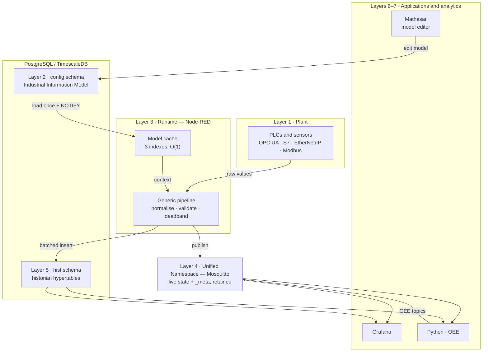
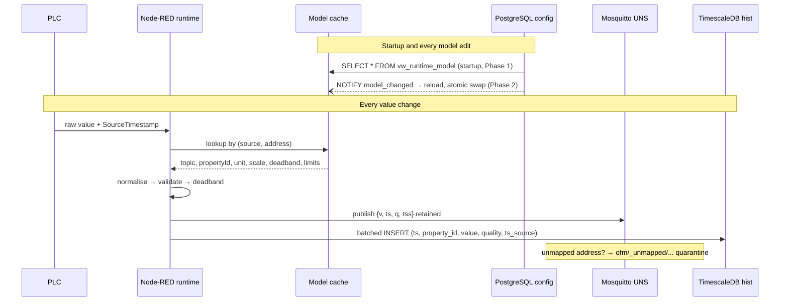

# Open Factory Model (OFM)
## Architecture Overview

| | |
|---|---|
| **Document** | OFM Architecture Overview |
| **Version** | 0.6.4 (2026-10-30) — model changes reach the runtime without restart (§7.2, step 2.1) |
| **Status** | Living document — updated as decisions are made |
| **Audience** | Engineers building, operating, or contributing to OFM |
| **Companion documents** | Architecture Decision Records (`docs/adr/`), payload JSON Schemas (`schemas/`), database migrations (`db/migrations/`) |

This document is deliberately short. It explains what OFM is, why it is shaped the way it is, and where every deeper detail lives. Anything that can be generated from the information model (topic trees, tag lists, data dictionaries) is *not* documented here — generating it is the point of the platform. Anything that records a contested decision lives in an ADR, not here. This document should be readable in under an hour and should still be true in a year.

---

## 1. Executive summary

OFM (Open Factory Model) is an open-source industrial data platform for manufacturing plants. It provides a single source of truth for operational technology (OT) data by combining two ideas that are usually implemented separately:

**A Unified Namespace (UNS)** — an MQTT broker carrying the live state of the entire plant in a business-oriented topic hierarchy, so that every application (dashboards, MES functions, analytics, AI) consumes one consistent, contextualised stream instead of integrating point-to-point with PLCs.

**An Industrial Information Model (IIM)** — a relational model of the factory in PostgreSQL/TimescaleDB that describes every enterprise, site, area, line, machine, and property, together with its engineering metadata (units, limits, deadbands, PLC mappings). The UNS is *generated from* this model rather than configured by hand.

The defining architectural principle is that OFM is **model-driven**: the database is the single authoritative description of the factory, and every other component — MQTT topics, retained metadata, historian mappings, dashboards, documentation — is derived from it. Adding a sensor to the platform means inserting rows into the model, not editing flows or typing topic strings.

The platform is built entirely from components that are free to self-host: Node-RED as the runtime engine, Eclipse Mosquitto as the UNS transport, PostgreSQL/TimescaleDB as both the information model and the historian, Grafana for visualisation, and Python for analytics. All are open source except TimescaleDB's compression and continuous-aggregate features, which are free to self-host under the source-available Timescale License (section 12 lists each licence). The initial deployment target is a single food-manufacturing site (chocolate production, Melbourne), scaling from one line to plant-wide coverage; the architecture deliberately leaves room for multi-site growth without requiring it.

## 2. Vision and design philosophy

The vision is a plant where the question "what is happening on Line 1 right now, and what happened last Tuesday?" has exactly one answer, obtainable without knowing anything about PLC addresses, vendor protocols, or which engineer wired which flow.

Commercial platforms in this space (HighByte, Ignition, and others) achieve this with a modelling layer coupled to a proprietary runtime. OFM's bet is that the same result can be achieved with a well-designed relational model plus commodity open-source runtimes — and that the model being an ordinary PostgreSQL database, queryable and editable with ordinary tools, is a feature rather than a compromise.

Seven principles govern every design decision. Where a principle was contested or has real costs, the corresponding ADR records the argument.

**Model-driven above all.** The information model generates the system. If a piece of configuration exists outside the database — a topic string typed into a flow, a unit hardcoded in a dashboard — it is a defect to be migrated into the model.

**Configuration over code.** Commissioning a new machine or tag must never require editing a Node-RED flow. Flows are generic executors; the model tells them what to do.

**Context before data.** No value enters the UNS without its business context: which machine, which property, what unit, what quality. Raw register values and PLC addresses never appear north of the runtime layer.

**Loose coupling through the namespace.** Applications never talk to PLCs and never talk to each other directly. They publish to and subscribe from the UNS, or query the historian. Any component can be replaced without the others noticing.

**Separate live state from permanent record.** MQTT distributes current state; TimescaleDB is the durable record. These are different jobs with different guarantees, served by different paths (ADR-0002).

**Honest data quality.** Every value carries a quality flag and a timestamp provenance marker (ADR-0003). The platform prefers visibly flagged uncertainty over silently plausible data.

**Boring technology, few moving parts.** Every component must be self-hostable by a small team, widely documented, and replaceable. New infrastructure (caches, queues, brokers) is added only when a measured problem demands it.

## 3. Scope and requirements

### 3.1 Functional scope

OFM version 1 covers: acquisition of data from industrial controllers (OPC UA as the preferred protocol; Siemens S7, Rockwell EtherNet/IP (Logix controllers), Modbus TCP and MQTT-native devices as required); normalisation to engineering units and a canonical payload; contextualisation against the information model; publication to the UNS with retained metadata; durable storage of measurements, events, machine states, and production counts in TimescaleDB; operator capture of downtime reason codes and comments; manual entry of work orders; efficiency KPIs (GE, OEE with its availability, performance and quality factors, Downtime, MTBF, MTTR, CU, LU, TEEP) from a time-based loss waterfall at machine and line level; an operator whiteboard; statistical process control (SPC) of sampled product characteristics such as pack weight and temper index; food safety check records (HACCP critical control points and prerequisite programmes); traceability of finished lots to raw-material lots, with inventory derived from material movements; and visualisation through Grafana.

Explicitly out of scope for version 1: closed-loop control through the platform (PLCs remain the control authority; OFM writes setpoints only where a deliberate, per-tag decision is recorded), recipe management beyond identification of the active product, ERP/SAP integration (work orders are entered manually in v1), the HACCP plan itself (OFM records checks against it), multi-site federation, and safety functions of any kind. Safety circuits and E-stops remain entirely on dedicated safety PLCs and are invisible to OFM.

### 3.2 Non-functional targets

These are engineering targets for a single site, not guarantees; they size the design.

| Concern | Target |
|---|---|
| Tag capacity | 5,000 mapped properties per Node-RED instance |
| Ingest rate | 2,000 value changes/second sustained |
| UNS latency (PLC change → MQTT publish) | < 250 ms typical |
| Model edit → runtime effect | < 1 s (cache reload via NOTIFY) |
| Historian completeness | No loss across broker restarts or DB outages ≤ queue capacity |
| Historian retention | Raw: 90 days; downsampled aggregates: 5 years (tunable per property class) |
| Recovery point objective | ≤ 24 h for the model; ≤ store-and-forward queue depth for telemetry |
| Availability posture | Single-node, restart-tolerant; no HA clustering in v1 |
| Network posture | Runs fully offline on an isolated automation network; internet access is never required after installation |

## 4. System context — the seven layers

OFM organises responsibilities into seven layers. Each layer talks only to its neighbours; the numbering runs from the physical plant upward.

**Layer 1 — Industrial assets.** The physical plant: lines, machines, motors, valves, sensors, and the PLCs controlling them. OFM observes this layer; it does not replace any part of it.

**Layer 2 — The Industrial Information Model.** The PostgreSQL schema describing Layer 1 and everything OFM should do with its data. Detailed in section 5.

**Layer 3 — The runtime.** Node-RED instances executing generic, model-driven flows: read from controllers, resolve context from the cached model, normalise, validate, publish, and record. Detailed in section 7.

**Layer 4 — The Unified Namespace.** Mosquitto carrying live plant state as retained-where-appropriate MQTT topics in the ISA-95-style hierarchy generated from the model. The UNS holds *current state only* — it is the plant's live digital twin, not its memory.

**Layer 5 — The historian.** TimescaleDB hypertables holding the permanent record: measurements, events, machine state events (from which intervals are derived), production counts, energy. History is append-only (ADR-0006). Shares the PostgreSQL instance with Layer 2 but lives in a separate schema with separate access roles.

**Layer 6 — Applications.** Grafana dashboards, operator screens, Python services, future MES functions. Applications subscribe to the UNS for live data and query the historian for history. They never communicate with Layers 1–3 directly.

**Layer 7 — Analytics.** OEE, energy KPIs, SPC (section 10.5), and future AI reasoning, computed from the historian and published back into the UNS (e.g., a live OEE topic per line) so that derived insight becomes just another part of the namespace.

The layering rule that matters most in practice: **PLC addresses exist only in Layers 1–3; business context exists everywhere above.** A Grafana dashboard, a Python script, or an AI assistant can be written by someone who has never heard of DB20 or a holding register.

*Figure 1 — System architecture. The model feeds the cache (ADR-0001); the pipeline has two independent outputs: live state to the UNS, permanent record to the historian (ADR-0002). Applications touch only Layers 4–5.*



## 5. The three models

The information model is deliberately split into three sub-models with different lifecycles. The split keeps the schema clean and mirrors three distinct questions about a factory.

**The Physical Model — what exists.** The asset hierarchy: Enterprise → Site → Area → Line → Machine, with optional sub-assets (motor, valve, sensor) below machine level. Rows here change rarely — when equipment is installed, moved, or renamed. Every entity carries an immutable integer ID and a mutable name, unique within its parent; all foreign keys and all historian rows reference the ID, never the name (ADR-0004). Renaming `Line01` to `MouldingLine01` is therefore a one-column update that re-derives every topic, clears the old retained topics from the broker, and leaves five years of history intact. Entities with history are retired (`retired_at`), never deleted.

**The Information Model — what is measured.** `machine_property` and its supporting tables: for each machine, the properties observed on it (temperature, speed, running, power…), each with datatype, engineering unit (from an `engineering_unit` lookup table, so `degC`, `°C` and `C` cannot coexist), scaling, deadband, maximum publish interval (ADR-0007), alarm limits, historian policy, and display metadata. A `source` table describes each acquisition connection (a PLC or OPC UA server: protocol, endpoint, owning runtime instance). The `plc_mapping` table binds each property to an address on a source, unique per `(source_id, address)` because two PLCs can expose the same address (ADR-0001 amendment). Mappings are expected to change independently of properties — when maintenance moves a tag from `DB20.Temp` to `DB30.Temp`, one mapping row changes and nothing else in the system notices. OPC UA addresses are stored with the namespace URI (`nsu=http://…;s=Temperature`) rather than the namespace index (`ns=3;s=Temperature`): OPC UA guarantees the URI, while the index may differ between server versions and restarts. The runtime resolves the index when it connects.

**The Operational Model — what happens over time.** Entities that exist only in time: machine state events, reason-code assignments, work-order execution events, SPC samples, food safety check records, material lots and movements, production counts, shifts, operators, alarms, batches. All instances are recorded append-only — rows are inserted, never updated (ADR-0006). These tables sit at the boundary between configuration and history: their *definitions* (the state vocabulary, the reason-code catalogue and its loss-waterfall mapping, the shift calendar and schedule, materials — raw, semi-finished and finished — rated speeds, work orders, quality characteristics, specifications, sampling plans, control limits and food safety check definitions) are configuration; their *instances* are historian data.

All database identifiers are lowercase snake_case (ADR-0005); names such as `MachineProperty` in older material refer to `machine_property`.

Everything else in OFM derives from these three models. The MQTT topic for a property is a deterministic function of its Physical-Model ancestry plus its property name, computed in the `vw_runtime_model` view. The retained `_meta` payload is a projection of Information-Model columns. Historian tables key on Information-Model IDs. Grafana dashboards are (in later phases) templated from the model. A separate `asset_relationship (from_machine_id, to_machine_id, relation_type)` table is present from Phase 1 but unused until the semantic-graph work in section 19 — it is there so that the door stays open without committing to a vocabulary prematurely.

## 6. The Unified Namespace

### 6.1 Topic standard

Topics encode business context only, following the Physical Model hierarchy:

```
{enterprise}/{site}/{area}/{line}/{machine}/{property}
acme/melbourne/chocolate/eggline01/depositor01/temperature
```

Naming rules are enforced by the database (CHECK constraints on name columns), not by convention: lowercase, `a–z0–9_` only, no spaces, and never the MQTT-reserved characters `#`, `+`, `/` inside a segment. Because topics are generated, a malformed topic cannot reach the broker. Sub-asset properties extend the path by one segment (`.../depositor01/motor01/current`). The enterprise name `ofm` is reserved, so the platform branches below can never collide with the asset tree. Line-level topics (`.../{line}/workorder`, `.../{line}/kpi/{name}`, `.../{line}/spc/{characteristic}`, `.../{line}/foodsafety/{check}`; ADR-0010, ADR-0011, ADR-0015) make `workorder`, `kpi`, `spc` and `foodsafety` reserved machine names. (`acme` is a placeholder enterprise used in all examples.)

Three reserved first-level branches exist outside the asset hierarchy: `ofm/_system/...` for platform health (cache status `ofm/_system/cache/{runtime}`, historian writer status `ofm/_system/historian/{runtime}`, source status `ofm/_system/sources/{source}` and runtime status `ofm/_system/runtime/{runtime}` per ADR-0007; per runtime, because section 7.3 allows several instances), `ofm/_unmapped/{source}/{address}` for quarantined values whose address is not in the model (ADR-0001; `/`, `+` and `#` in the address are replaced by `_`, and the original address travels in the payload), and `ofm/_cmd/...` for the deliberate, per-tag write-back paths, kept separate so that ACLs can treat commands differently from telemetry.

### 6.2 Live payload

Every telemetry topic carries one canonical JSON payload, defined normatively in `schemas/value.schema.json`:

```json
{
  "v": 25.4,
  "ts": 1783948925123,
  "q": "good",
  "tss": "device"
}
```

`v` is the value after normalisation (engineering units, correct datatype); `ts` is epoch milliseconds UTC; `q` is quality (`good` | `uncertain` | `bad`); `tss` is timestamp provenance (`device` | `gateway`) per ADR-0003. Keys are terse deliberately — this payload is published thousands of times per second and parsed by everything. Values are published retained, so any newly connected subscriber immediately receives current plant state. A value is published when it changes beyond its deadband, and in any case at least once per `max_publish_interval_ms` (default 60 s), so a consumer can treat a value older than twice its interval as stale. When a source loses communication, the runtime republishes all its properties with their last value and `q: "bad"` (ADR-0007). Values read by S7 or EtherNet/IP polling carry no device time and are always `tss: "gateway"` (ADR-0003 amendment).

### 6.3 Metadata topics

Each property additionally exposes `.../{property}/_meta`, retained, republished only when the model changes, defined normatively in `schemas/meta.schema.json`:

```json
{
  "propertyId": 145,
  "datatype": "float",
  "unit": "degC",
  "displayName": "Chocolate temperature",
  "low": 18.0, "high": 35.0,
  "maxPublishIntervalMs": 60000,
  "alarmLow": 20.0, "alarmHigh": 32.0,
  "description": "Chocolate after temperer"
}
```

The split between live and meta topics keeps the hot payload small while making the namespace self-describing: a consumer can discover the entire plant, with engineering context, by subscribing to `+/+/+/+/+/+/_meta` and, for sub-asset properties, `+/+/+/+/+/+/+/_meta`, without ever touching the database. When a property is renamed or retired, its old value and `_meta` topics are cleared with an empty retained message (ADR-0004). The `propertyId` field is the bridge for consumers that need to join UNS data with historian queries.

### 6.4 What the UNS is not

The UNS carries current state, not history and not guaranteed delivery. Consumers requiring completeness read the historian (ADR-0002). The broker is Mosquitto with per-role ACLs, TLS (from Phase 2), and no anonymous access (section 13). Plain MQTT with JSON was chosen over Sparkplug B for v1 because human-readable payloads and a hand-shaped ISA-95 tree were judged more valuable at single-site scale. Sparkplug's one essential feature — birth/death certificates that expose dead sources — is replaced by OFM's own liveness signalling (ADR-0007). The choice is revisitable in a future ADR if multi-site or Ignition interoperability changes the calculus.

## 7. Runtime architecture

### 7.1 The generic pipeline

Node-RED runs a small number of *generic* flows; none contains machine-specific logic. The ingest pipeline for every value is:

```
acquire (OPC UA subscribe / S7 and EtherNet/IP poll / Modbus poll)
  → cache lookup ((source, address) → property context)  [O(1), no SQL]
  → normalise (scale, cast, unit)
  → validate (range, datatype, timestamp sanity)
  → deadband + rate limit + max-interval republish (per-property policy)
  → publish UNS (retained, canonical payload)
  → historian write (batched, parallel path)
```

The acquisition step is generic: one component opens a connection per source listed in the model, resolves OPC UA namespace URIs to the server's current numbers, and subscribes to every mapped address, so a new PLC or tag is a model change only (ADR-0017). Controllers without OPC UA — Siemens S7 and Rockwell Logix — are read the same way by a polling component that sends a value only when it changes or is due again (ADR-0018). The flows themselves are code, kept in the repository and free of secrets (ADR-0016). Unmapped addresses divert to quarantine after the lookup step. Separately from the per-value path, the runtime watches each source connection: on loss it publishes the source status, republishes the affected properties as `bad`, and records `unknown` for the affected machines (ADR-0007, ADR-0006). Write-back (`_cmd`) flows run the pipeline in reverse with explicit per-tag enablement in the model.

*Figure 2 — Runtime data flow. The model-change path (top) and the per-value path (bottom) never intersect: configuration edits reach the runtime through cache reload, and the hot path issues no SQL for model resolution.*



### 7.2 The model cache

Per ADR-0001, the runtime never queries SQL on the hot path. On startup, Node-RED loads `SELECT * FROM vw_runtime_model` — a view that pre-joins the full Physical and Information Models and pre-computes each property's topic — and builds three global-context indexes: by `(source, address)` (ingest), by machine ID (state and OEE logic), and by MQTT topic (command path). The startup load is part of Phase 1, so the hot path never issues SQL even in the first phase. Statement triggers on every configuration table send `NOTIFY model_changed` with the table name (migration 009); a listener in the runtime combines notifications arriving within 300 ms, reloads the view and atomically swaps the indexes, giving a model-edit-to-runtime latency under one second with no restarts and no polling. Each reload compares the old and new topic sets and clears retained topics, and status topics of sources, that no longer exist (ADR-0004). Acquisition reconnects only the sources whose endpoint, settings or address list changed; scaling, limits and names take effect without touching the PLC connection. After losing its database connection the listener reloads once on reconnecting, because notifications sent meanwhile are lost.

### 7.3 Runtime topology

One Node-RED instance per plant is the Phase 1 topology. The scaling unit is the instance: if tag count, CPU, or blast-radius concerns demand it, additional instances are added per area or per line, each owning a disjoint set of sources (an owning-instance column on `source`) and each running the identical generic flows against the same model. Every instance announces itself on `ofm/_system/runtime/{runtime}` with an MQTT Last Will, and writes a heartbeat row to the historian (ADR-0007, ADR-0006). Node-RED is single-threaded; the ceiling per instance is expected around the targets in section 3.2 and will be validated with load tests in Phase 2.

## 8. Historian architecture

Per ADR-0002, history is written directly from the runtime to TimescaleDB, in parallel with — never through — the broker. Telemetry inserts are batched (1–2 s flush); MES-significant events (state events, reason assignments, work-order events, counts) are written transactionally per event. A local disk queue provides store-and-forward across database outages, with queue depth exposed on `ofm/_system/historian/{runtime}`.

The historian schema is narrow and ID-keyed. `measurement (ts timestamptz, property_id int, value double precision, quality smallint, ts_source smallint)` is a hypertable partitioned on `ts`; text values and states go to sibling tables rather than overloading one table with nullable columns. Native TimescaleDB compression is applied after 7 days and continuous aggregates maintain 1-minute and 1-hour rollups per property, which serve most dashboard queries and the 5-year retention tier while raw data ages out at 90 days. Operational-Model instance tables (`machine_state_event`, `state_reason`, `work_order_event`, `production_count`, `event`, `runtime_heartbeat`) follow the same pattern: immutable IDs, `timestamptz`, no display names — and all are append-only: the runtime's database role can SELECT and INSERT in `hist` but never UPDATE or DELETE (ADR-0002 amendment, ADR-0006). Inserts are idempotent (`ON CONFLICT DO NOTHING`), so a store-and-forward queue replayed twice is harmless.

Nothing in the historian references topics or display names. Historical queries join to the model at read time, so equipment renames and topic restructures never corrupt history.

## 9. Timestamps and data quality

ADR-0003 in one paragraph: source timestamps (OPC UA `SourceTimestamp`, publisher time for MQTT sources) are used whenever available, gateway arrival time is the flagged fallback, and provenance travels with every value (`tss` in payloads, `ts_source` in the historian). All times are epoch milliseconds UTC in the data path; Australia/Melbourne local time exists only in display layers. Nothing is rejected: a device timestamp more than 5 minutes ahead of gateway time is replaced by gateway time and flagged `uncertain` (a future timestamp would otherwise masquerade as the current value), and a device timestamp that goes backwards is kept and flagged `uncertain` — making unsynchronised PLC clocks a visible data-quality signal (ADR-0003 and its amendment). NTP synchronisation of PLCs, runtime host, and database host is a commissioning-checklist item for every device.

Data quality also covers *liveness*: a value that stopped arriving must not look like a value that stopped changing. Source status topics, bad-quality republication on communication loss, the runtime's MQTT Last Will, and the maximum publish interval together make a dead source, a dead runtime and a stable process distinguishable to every consumer, live and in history (ADR-0007).

## 10. Operations: states, efficiency, work orders, quality, food safety and traceability

### 10.1 State model

Machine states are captured as *transitions*, not derived after the fact, and recorded append-only (ADR-0006). Each machine's state — from the fixed vocabulary `running, idle, blocked, starved, fault, setup, cleaning, maintenance, unknown` — is evaluated in the runtime from PLC signals according to per-machine rules stored in the model. On every transition, the runtime publishes the new state to the UNS (retained, so current state is always readable at `.../{machine}/state`) and inserts one complete row into `machine_state_event (machine_id, ts, state_id, source)`. No row is ever updated: the view `vw_machine_state_interval` derives each interval's end from the next event's start, so a machine can never have more than one open interval. Deriving states retrospectively from raw signals is explicitly rejected: transition-time capture is simpler, auditable, and gives operators something to annotate while memory is fresh.

`unknown` records time the platform could not observe. It is inserted when a source loses communication (at the moment of loss) and after a runtime outage: on startup, the runtime inserts `unknown` at the later of its last heartbeat and each machine's last event, then reads and records the actual state. States are recorded per machine; line, area and site states are derived (the derivation rule is an open question in ADR-0006).

The vocabulary is fixed platform-wide; per-machine mapping from PLC signals to states is configuration. `cleaning` is first-class rather than a downtime reason because in food manufacturing hygiene time is planned, measured, and excluded differently from failure time in OEE availability.

### 10.2 Reason codes and the operator

Downtime *causes* cannot come from the PLC. When a stoppage (any non-`running` interval outside planned exclusions) exceeds a configurable threshold, an operator screen — Node-RED Dashboard 2.0 in early phases — presents the reason-code catalogue from the Operational Model, filtered to that machine's applicable codes, and inserts the selection — with an optional free-text comment — into `state_reason`, linked to the state event it explains by `(machine_id, event_ts)`. Every reason maps to exactly one loss-waterfall position, so coding a stop also classifies it (ADR-0009). Stops shorter than the line's minor-stop threshold are classified automatically as minor stops and need no coding. PLC fault codes, operator selections and supervisor corrections are all separate rows; the latest assignment is the effective reason, and the full history of changes is kept automatically. Uncoded stops above the threshold remain visible as "unaccounted" on dashboards and in the waterfall; making the gap visible is the enforcement mechanism, not blocking the operator.

### 10.3 Manufacturing efficiency metrics

All efficiency KPIs derive from one time-based loss waterfall (ADR-0008). Calendar time steps down through loss categories to good production, so the positions always sum to calendar time and every KPI is a ratio of two positions. The 13 positions are reference data in the model:

| Pos | Category | Type | Reduces |
|---|---|---|---|
| 1 | Maximum Time | Milestone (calendar time) | — |
| 2 | No Activity | No activity: not scheduled, no demand, force majeure | LU, CU, TEEP |
| 3 | Hours Used | Milestone (scheduled time) | — |
| 4–7 | Maintenance, Cleaning, Changeover, Other Planned DT | Planned downtime | GE, TEEP |
| 8 | Production Hours | Milestone | — |
| 9 | Breakdowns | Unplanned downtime | GE, OEE, TEEP |
| 10 | Speed Loss | Performance (calculated) | GE, OEE, TEEP |
| 11 | Quality Loss | Quality (calculated) | GE, OEE, TEEP |
| 12 | Other Unplanned DT | Minor stops, starved/blocked, shortages | GE, OEE, TEEP |
| — | Unaccounted | `unknown` time and uncoded stops | GE, OEE, TEEP |
| 13 | Operating Time | Milestone (good count × ideal cycle time) | — |

**Operations KPIs** (real time, shift, day): GE = Pos 13 ÷ Pos 3; OEE = Pos 13 ÷ Pos 8, shown with its factors availability, performance and quality (OEE = A × P × Q); Downtime = Pos 9 + Pos 12 + unaccounted, in hours; MTBF = running time ÷ number of breakdowns; MTTR = breakdown duration ÷ number of breakdowns, both per machine. **Management KPIs** (week, month, year): GE, OEE, LU = Pos 3 ÷ Pos 1, CU = Pos 3 ÷ defined capacity, TEEP = Pos 13 ÷ Pos 1 = LU × GE.

Downtime positions come from classifying state intervals (ADR-0009): outside the schedule is No Activity; a coded stop takes its reason's position; changeover and planned windows apply to uncoded stops; short stops become minor stops; everything else is unaccounted until coded. Speed and quality losses are not events but are calculated from good and reject counts and the ideal cycle time of the active product (ADR-0010). A performance above 100 % flags a rated speed set too low; it is never clipped.

Line KPIs come from line output counts and the line state — the state of the line's constraint machine, or of a line-level machine where the PLC provides one — never from summing machines, which would double-count starvation. Periods are bounded in Melbourne local time, so a daylight-saving day has 23 or 25 hours. KPIs are SQL views calculated at read time, so a late reason or a schedule correction updates every affected figure; each result carries the `kpi_definition_version` of the rules that produced it. Live line KPIs are republished to `.../{line}/kpi/{name}` so they are ordinary namespace citizens. Terminology follows ISO 22400-2 where equivalents exist; GE is OFM's named variant.

### 10.4 Work orders and the operator whiteboard

KPIs need to know what is being made. Products — materials of type finished or semi-finished in the single material master (ADR-0014) — and their rated speed per line live in the model as effective-dated rows, so a rate change never rewrites history. Work orders (SKU, line, planned quantity) are master data, planned ahead or created on the spot. Their execution is append-only: `start`, `changeover_end` and `complete` events in `hist.work_order_event`. Starting a new order completes the previous one and opens a changeover window, which closes at `changeover_end` or the first good count. The active order is derived from the events and published retained on `.../{line}/workorder` (ADR-0010).

The operator whiteboard (Node-RED Dashboard 2.0) is the shift-floor screen: one row per hour with produced count against target, the hour's GE, rejects, and the list of stops with type, duration, reason and comment. Each hour's bar is the loss waterfall expressed in units: good count plus the unit-equivalent of every stop and of the speed loss adds up to the hourly target. Operators code stops, add comments, and start and complete work orders on this screen, and it reminds them to start the new order when a changeover begins. Grafana carries the analytical dashboards: GE, OEE and A·P·Q trends, downtime Pareto by reason, MTBF and MTTR per machine for operations, and the weekly-to-yearly GE, OEE, CU, LU and TEEP views for management.

### 10.5 Statistical process control

SPC monitors *product characteristics* — pack weight, temper index, crystallisation temperature, moisture — rather than machine time (ADR-0011). It is separate from the quality loss in the efficiency waterfall, which counts rejects; SPC watches variation before it becomes rejects.

Each characteristic is defined once in the model, with its unit and kind (measured value or attribute such as a pass/fail check). Each product carries effective-dated specification limits (LSL, target, USL). A sampling plan per line and characteristic sets the subgroup size, the sampling interval, the chart type (X̄-R, X̄-S, I-MR, p, np, c, u) and the out-of-control rules. Samples are recorded append-only with who took them, for which work order, and from which source: entered by an operator or lab technician on a Node-RED Dashboard screen, read from an instrument, or formed automatically from an inline property such as a checkweigher (such properties are stored without deadband). A wrong entry is corrected by a new sample that voids it.

Control limits are calculated from an approved baseline period and then **frozen** as effective-dated rows; they are never recalculated automatically, because limits that follow the process would hide the shifts SPC is meant to reveal. Chart points, rule violations and capability indices (Cp, Cpk, Pp, Ppk) are SQL views evaluated against the limits valid at each sample. Each new sample is checked against the plan's rules; violations are recorded, and each characteristic's state — in control, violation, sample overdue, no control limits — is published to `.../{line}/spc/{characteristic}`. Grafana draws the control charts. OFM supports SPC; whether its records meet trade-measurement, customer or food-safety requirements is for the site's quality function to confirm.

### 10.6 Food safety checks

The HACCP plan's critical control points and prerequisite programmes — metal detector tests, cooking and cooling temperatures, cleaning and allergen changeover verification, foreign-body checks — are recorded in OFM rather than on paper (ADR-0015). Each check is defined once in the model: what is checked, where, how often (by interval, per shift, per work-order start or changeover), whether it is a CCP, and its critical limits. Records are append-only, signed by the person who performed them, and linked to the work order and, from Phase 3e, the lot. A failed check stays open until a corrective action (including product disposition) is recorded, and a second person verifies it; the database refuses self-verification. A CCP measured by an instrument can be linked to a property, so a value outside its critical limits raises a deviation automatically. The state of every check — done, due, overdue, failed and open — is published to `.../{line}/foodsafety/{check}`. Food safety checks reuse the SPC machinery (entry screens, overdue logic, publication) but keep their own tables, because corrective actions and verification have no SPC equivalent. OFM records checks; the HACCP plan, its validation and the acceptance of electronic records by a certification scheme remain with the site's quality function.

### 10.7 Traceability and inventory

Traceability answers two questions on demand: what went into this finished lot, and where did this raw-material lot go (ADR-0014). Every material — raw, ingredient, packaging, semi-finished, finished — is defined once in a single material master, from Phase 3a. Each lot received or produced is a row with an immutable identity; supplier and ERP codes are attributes. Everything that happens to material is an append-only movement — received, transferred, consumed, produced, adjusted, disposed — recorded from PLC totals (flow meters, weigh scales), operator scans and entries, and later ERP. Stock on hand, the lot genealogy, recall scope and mass balance are views over the movements, never stored totals, so every quantity can be explained movement by movement. Tanks, silos and hoppers are storage equipment in the physical model; their level properties flow as usual and cross-check the movement-based contents. Because chocolate and jelly processes are largely continuous, lots mix in vessels: a lot is attributed to everything drawn from a vessel during the window in which it may have been present, with a deliberately conservative default — when in doubt, the lot is in the recall scope. The exact attribution rules get their own ADR when Phase 3e is designed.

## 11. Configuration management

The model is edited through three doors, all converging on the same PostgreSQL schema with the same constraints and audit trail. **Mathesar** (ADR-0013) provides the human interface in early phases: spreadsheet-style grids over the configuration schema with related rows chosen from pick-lists, while the database's constraints reject invalid entries — deferring any custom UI until the schema has survived contact with reality. **SQL migrations** (numbered files under `db/migrations/`, applied in order by a small runner on every start of the stack and recorded with checksums in the database, ADR-0012) are the only mechanism that changes schema *structure*; the migration history in Git is the schema documentation, and `docs/generated/erd.md` is its diagram, regenerated from the live database. **Direct SQL** remains available to engineers, because the model being an ordinary database is the point.

Every configuration table carries `created_at, created_by, updated_at, updated_by`, and an `audit_log` table records old/new row images via trigger. In a food plant, "who changed the alarm limit on that temperature and when" is a question with a compliance dimension; the platform must answer it without archaeology. Attribution is per person: everyone who edits the model has a personal database login (a member of `ofm_config`), which the model editor uses on their behalf, so the audit log and `updated_by` record the person, not a shared role (ADR-0013). Model changes propagate to the runtime via NOTIFY (section 7.2) and to consumers via republished `_meta` topics — no restarts anywhere.

## 12. Technology stack

| Role | Choice | Licence | Why this, briefly |
|---|---|---|---|
| Information model + historian | PostgreSQL 16 + TimescaleDB | PostgreSQL Licence; TimescaleDB core Apache 2.0, compression and continuous aggregates Timescale License (free to self-host, source-available) | One engine for both jobs; excellent relational core; hypertables, compression, continuous aggregates for time-series |
| Runtime | Node-RED | Apache 2.0 | Protocol node ecosystem (OPC UA, S7, Modbus), low-code visibility for OT engineers, good-enough throughput per instance |
| UNS transport | Eclipse Mosquitto | EPL 2.0 / EDL 1.0 | Lightweight, ubiquitous, MQTT 5, trivial to operate; clustering not needed at single-site scale |
| Visualisation | Grafana | AGPL 3.0 | First-class TimescaleDB and MQTT support; the de facto standard |
| Analytics | Python | PSF | OEE jobs, SPC, future AI; talks natively to both PostgreSQL and MQTT |
| Config UI (interim) | Mathesar | GPL-3.0 | Spreadsheet-style editing directly on the live schema, using PostgreSQL roles, with zero custom code |
| PLC drivers (in the runtime image) | node-opcua; @st-one-io/nodes7; st-ethernet-ip | MIT; GPL-3.0; MIT | Used directly by the model-driven acquisition components (ADR-0017, ADR-0018); pinned |
| Development data source | OPC PLC simulator (Microsoft) | MIT | Realistic OPC UA test server; lets anyone run the full pipeline without hardware |
| Deployment | Docker Compose | Apache 2.0 | Whole platform as one reviewable file; sufficient below Kubernetes scale |

Substitution points are deliberate: EMQX can replace Mosquitto if clustering is ever needed; additional Node-RED instances (or a Benthos pipeline for a hot path) can join without touching the model; Grafana is replaceable by anything that speaks SQL and MQTT. Container images are pinned to exact versions in the Compose file; an upgrade is a deliberate, reviewed commit, never a side effect of `docker compose pull`. The model schema is the one component with real switching costs, which is why it gets migrations, audit, and ADRs while everything else gets a Compose entry.

## 13. Security architecture

OFM assumes a segmented OT network and adds application-layer controls on top; it never substitutes for network segmentation. The runtime host sits in the OT/IT DMZ pattern: plant protocols (S7, EtherNet/IP, Modbus, OPC UA) terminate at the runtime and are never routed north; only MQTT-over-TLS and PostgreSQL-over-TLS cross upward. Modbus, S7 and EtherNet/IP have no native security (S7 additionally needs PUT/GET access enabled on S7-1200/1500), so their segments are isolated at the network layer; OPC UA connections use signed-and-encrypted mode with certificates where the controller supports it.

Mosquitto runs with TLS, no anonymous access, and per-role ACLs: acquisition credentials may publish telemetry but not `_cmd`; applications may subscribe broadly but publish nothing; only the command flow's credential may publish `_cmd`, and only operator-facing services may trigger it. PostgreSQL follows the same least-privilege split — `ofm_runtime` (SELECT on model; SELECT and INSERT on historian, never UPDATE or DELETE), `ofm_config` (DML on configuration schema; held by the model editor's role `ofm_mathesar` and by personal editing logins), `ofm_reader` (Grafana/analytics, read-only) — so a compromised dashboard cannot alter the model and a compromised runtime cannot rewrite history. Secrets — including database role passwords — live in the deployment environment (Compose env files with restricted permissions in v1), never in flows or the repository. The Node-RED editor is protected by `adminAuth`, because anyone who can reach an unprotected editor can deploy code that runs next to the PLCs. In the single-laptop proof of concept, all service ports are bound to the loopback interface. Every component runs offline, with no dependency on external services at run time; most plant installations sit on automation networks without internet access.

## 14. Deployment architecture

The reference deployment is a single Docker Compose stack on one industrial-grade Linux host at the site: `timescaledb`, the one-shot `migrate` service (ADR-0012), `mosquitto`, `nodered`, `grafana`, `mathesar` with its small settings database `mathesar-db`, and — for development and demos only — the OPC UA simulator `opcplc`, plus named volumes for each stateful service and the store-and-forward queue directory. Optional services are switched on by Compose profiles in `.env`. The Compose file in the repository *is* the deployment documentation. Installation on a network without internet uses an offline bundle: the pinned images saved with `docker save` and loaded on the target, prepared before the plant pilot. For the same reason the Node-RED image is built with its protocol nodes included, rather than installing them from the internet.

Placement matters more than orchestration at this scale: the runtime must be network-close to the PLCs (polling latency, broadcast domains), and the historian benefits from local SSD. A second host can split the stack (runtime at the edge; database, Grafana and Mathesar on a server VM) with no architectural change — every arrow between containers is already TCP with TLS. Kubernetes is explicitly not used in v1; the operational cost is not justified for a single-site, restart-tolerant posture. The home-lab and the plant run the identical Compose file with different `.env` values, which keeps the development environment honest. The proof of concept runs on Windows 11 with Docker on WSL2. Docker Desktop is free only for personal use, education and small businesses; for use within a larger organisation, either licence it or run the free Docker Engine directly inside a WSL2 Linux distribution — the Compose file is identical either way.

## 15. Performance and scalability

The design scales in three independent dimensions. **Tags** scale by adding Node-RED instances partitioned by source ownership (section 7.3) — the cache, flows, and model are identical per instance. **Consumers** scale freely on the broker side; Mosquitto handles the realistic single-site subscriber count, and retained messages mean new consumers impose no replay load. **History** scales with TimescaleDB chunking, compression (~90 % typical on telemetry), and continuous aggregates that keep dashboard queries off raw data.

Known ceilings, recorded so they are watched rather than discovered: Node-RED single-thread throughput (validated by Phase 2 load test against the 2,000 msg/s target); Mosquitto's single-node nature (no HA — acceptable per section 3.2's availability posture; a broker restart costs seconds of live-state visibility and zero history thanks to ADR-0002); and PostgreSQL insert throughput, which batching keeps far below limits at target rates. Each ceiling has a named escape hatch (more instances; EMQX; ingest via a queue) that is deliberately *not* built until measurement demands it.

## 16. Backup and disaster recovery

Two things need protecting, and they differ. **The model** is small, precious, and slow-changing: nightly `pg_dump` of the configuration schema, retained 90 days, tested by an automated restore-and-diff job — plus, in effect, a second life in Git via migrations and in the database's own audit log. **The historian** is large and append-only: weekly base backup plus WAL archiving (pgBackRest) with the RPO defined by WAL shipping frequency; store-and-forward in the runtime covers database downtime up to queue capacity, so a restore loses no telemetry within that window.

Broker state is deliberately expendable — retained messages regenerate from the runtime within one publish cycle of each property, so Mosquitto needs no backup beyond its config file (in Git). Recovery of the full platform on fresh hardware is: restore PostgreSQL, `docker compose up`, and wait one cache-load plus one publish cycle. This procedure is rehearsed, not assumed — a DR rehearsal is a Phase 3b exit criterion.

## 17. Testing strategy

The strategy leans on the model-driven design: because flows are generic, testing effort concentrates on a small pipeline instead of per-machine logic. Five tiers. **Schema tests** (table-driven SQL cases, each run as the relevant role in a transaction that is rolled back) verify constraints, permissions, auditing, the naming rules, `vw_runtime_model` and `vw_machine_state_interval` correctness, and NOTIFY triggers. **Pipeline tests** run the ingest flow against a simulated source — the open-source OPC PLC simulator (MIT licence, `mcr.microsoft.com/iotedge/opc-plc`), whose ramps, random values, sine waves with spikes and dips, cycling good/bad/uncertain status nodes and simulated boiler exercise normalisation, quality mapping and validation; later a Modbus simulator — and assert the exact UNS payloads and historian rows produced, including deadband, quality-flagging, and quarantine behaviour. **Failure drills** are scripted, not aspirational: kill the broker mid-stream (history must be complete afterwards), kill PostgreSQL (UNS must keep flowing; queue must drain on recovery), send an unmapped address, send a skewed timestamp, cut a PLC connection (source status and `bad` quality must appear, ADR-0007), restart the runtime (the correct `unknown` interval must be recorded, ADR-0006), and replay the store-and-forward queue twice (no duplicates). **KPI tests** feed scripted state, reason, count and work-order sequences through the classification and KPI views and assert the expected waterfall, including that every period closes (positions sum to Maximum Time) on both daylight-saving days. **Load tests** validate the section 3.2 targets before each phase exit. Every automated tier runs with one command, `docker compose run --rm test` (`tests/README.md`), inside OFM's own Node-RED image, so it needs no internet; each phase's exit check is an automated `live` suite plus scripted drills with expected results.

The simulator doubles as the development environment and the Phase 1 data source: it runs as an optional container in the Compose stack, so anyone who clones OFM can run the full pipeline without PLC hardware. A real controller is simply a second `source` row, which is also how the home-lab-to-plant path stays credible.

## 18. Roadmap

| Phase | Deliverable | Exit criterion |
|---|---|---|
| 1 | Model schema (config + historian DDL as migrations, audit), Mosquitto with ACLs, OPC UA simulator in the stack, OFM Node-RED image with protocol nodes built in, model cache loaded at startup, generic ingest for one source, runtime Last Will and source status topics, Grafana | One simulated line's values flowing OPC UA simulator → UNS → historian → dashboard from model configuration only; a bench PLC may be added as a second source |
| 2 | Cache reload via LISTEN/NOTIFY, `_meta` topics and retained-topic cleanup, deadbanding and max-interval republish, `bad` quality on source loss, batched historian writer, store-and-forward, model editor accepted (ADR-0013), broker TLS, offline install bundle, load test | Model edit visible in runtime < 1 s; broker-kill and PLC-disconnect drills pass; 2,000 msg/s sustained |
| 3a | Append-only state events and derived intervals, runtime heartbeat and startup reconciliation, good/reject counts, material master (ADR-0014) and rated speeds, shift calendar, work orders, reason catalogue with waterfall mapping, operator whiteboard (reason coding, comments, work-order entry) | One line's shift whiteboard matches the plant's existing tool hour by hour; runtime-restart drill records the correct `unknown` interval |
| 3b | Time ledger and KPI views (GE, OEE with A·P·Q, Downtime, MTBF, MTTR, CU, LU, TEEP), KPI republication to the UNS, Grafana operations and management dashboards, DR rehearsal | Line waterfall closes for every period, including daylight-saving days; every KPI traceable to raw events; restore rehearsal documented |
| 3c | SPC: quality characteristics, material specifications, sampling plans, append-only samples, sample-entry screen, inline subgrouping, frozen control limits, rule evaluation and UNS publication, Grafana control charts and capability | Pack-weight and temper-index charts for one line, with violations and overdue samples raised live and every point traceable to a sample |
| 3d | Food safety checks: check definitions, append-only records, corrective actions, second-person verification, instrument-monitored CCP deviations, per-person sign-in on operator screens, overdue alerts | One line's metal detector and CCP temperature checks recorded electronically for a month alongside paper, with every failure carrying a verified corrective action |
| 3e | Traceability and inventory: lots, movements, storage equipment, scanning screens, stock views, genealogy, recall and mass-balance queries, mixing rules (own ADR) | A mock recall from one raw-material lot to finished lots completed from OFM data, with a mass balance, in under an hour |
| 4 | Dashboard templating from the model, Python analytics framework, semantic relationships (populate `asset_relationship`) | New machine gets default dashboards with zero Grafana editing |
| 5 | `node-red-contrib-ofm` custom nodes, REST API over the model, AI assistant over model + historian | Property commissioning via dropdowns; natural-language operational queries |

Each phase is independently useful; nothing in a later phase is load-bearing for an earlier one. 3c, 3d and 3e depend only on 3a (3d reuses 3c's machinery), so any of them can be brought forward if it becomes the more urgent need. A **plant pilot** — the stack on a plant server reading one real line — follows Phase 2, because broker TLS, store-and-forward and stale-data signalling should be in place before OFM touches a production network. Documentation grows with the phases: ADRs as decisions are made, generated artefacts (topic tree, data dictionary) from Phase 2, and the comprehensive reference document — the "book" — only once it can be written about working software and partly generated by it.

## 19. Future directions

### MES coverage map

What OFM covers, plans, or deliberately leaves to other systems, against the MES functions of ISA-95 Part 3:

| Function | OFM | Where |
|---|---|---|
| Data collection | Built from Phase 1 | UNS, historian (§6–8) |
| Production tracking | Phase 3a | Work orders, counts (§10.4) |
| Performance analysis | Phase 3b | Efficiency KPIs (§10.3) |
| Quality — SPC | Phase 3c | §10.5, ADR-0011 |
| Quality — food safety checks | Phase 3d | §10.6, ADR-0015 |
| Traceability and inventory | Phase 3e | §10.7, ADR-0014 |
| Alarm and event history | Not yet designed | Alarm limits exist in the model; recording and statistics to be designed |
| Energy management | Not yet designed | Energy KPIs from existing properties, following the §10.3 pattern |
| Detailed scheduling | Interface only | A dedicated planning or optimisation tool feeds OFM's schedule |
| Maintenance management | Interface only | MTBF/MTTR in OFM; work requests go to the existing CMMS |
| ERP integration | Later | Work orders, goods movements, confirmations (ISA-95 Part 5) |
| Recipe management and setpoint download | Out of scope | A control function; stays in the PLC/batch layer |
| Labour management | Minimal | Per-person sign-in on operator screens (Phase 3a/3d) |

### Anticipated directions

Three directions are anticipated by the architecture but deliberately unbuilt. **Semantic relationships**: populating `asset_relationship` with a curated vocabulary (`feeds`, `supplies`, `belongs_to`) turns the Physical Model into a graph, enabling impact analysis ("everything downstream of Tank01") and richer diagnostics; the vocabulary will be chosen after operating experience, not before. **Custom Node-RED nodes** (`node-red-contrib-ofm`): a Factory Asset node with cascading model-driven dropdowns replaces the generic subflow for commissioning ergonomics — valuable, but only worth building against a stabilised schema. **AI over the model**: because the model is a well-structured relational description of the plant and the UNS is self-describing, an LLM-based assistant can be grounded on `vw_runtime_model`, `_meta` topics, and historian aggregates to answer operational questions; the model-driven principle is what makes this tractable, and it is the long-term payoff of keeping that principle strict.

## 20. Document map

Where the details live, by concern: contested decisions and their alternatives → `docs/adr/` (ADR-0001 cache, ADR-0002 historian path, ADR-0003 timestamps, ADR-0004 immutable IDs, ADR-0005 naming, ADR-0006 append-only operational history, ADR-0007 stale-data signalling, ADR-0008 loss waterfall, ADR-0009 loss classification, ADR-0010 work orders, ADR-0011 SPC, ADR-0012 migrations, ADR-0013 model editor, ADR-0014 traceability, ADR-0015 food safety checks, ADR-0016 flows as code, ADR-0017 OPC UA acquisition, ADR-0018 S7 and EtherNet/IP acquisition, and successors; accepted ADRs change only by dated amendment lines or by superseding ADRs); current phase, next steps and open questions → `docs/STATUS.md`; payload contracts — live value, `_meta`, and `ofm/_system` status payloads → `schemas/*.schema.json` (normative); database structure → `db/migrations/` (normative) with diagrams regenerated from the live schema; deployment → `deploy/docker-compose.yml` and its `.env.example`; runtime flows and Grafana dashboards → `flows/` and `deploy/grafana/dashboards/`, kept as code (ADR-0016); tests and exit checks → `tests/` (`tests/README.md`); generated references (topic tree, tag list, data dictionary) → `docs/generated/`, produced by `tools/gen_docs.py` from the model and never edited by hand. When this overview and a normative artefact disagree, the artefact wins and this document gets a correcting commit.

---

*End of Architecture Overview v0.6.4. Corrections and challenges are welcome — disagreement with anything in sections 5–9 should arrive as a proposed ADR.*
